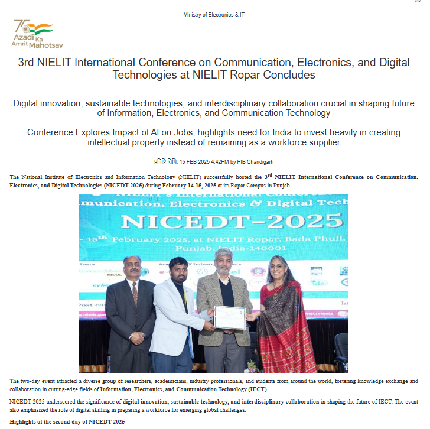
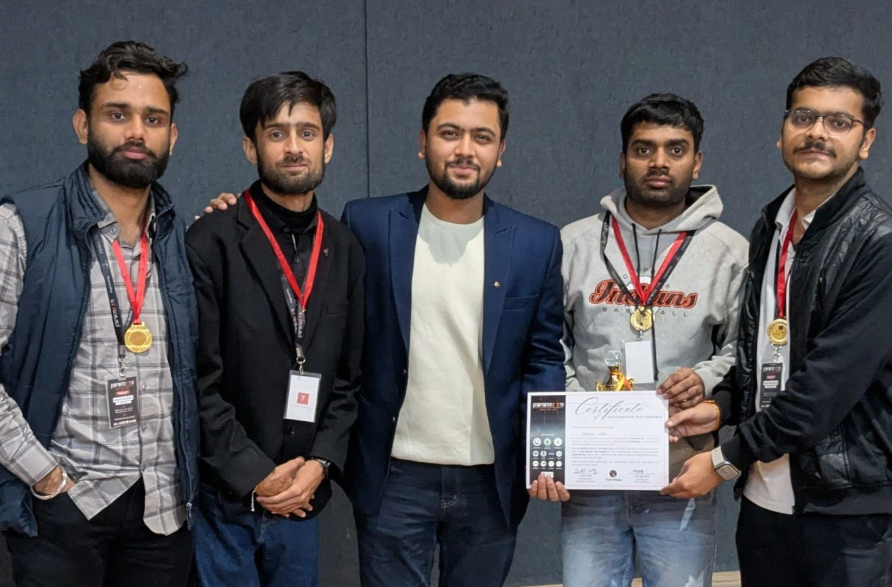
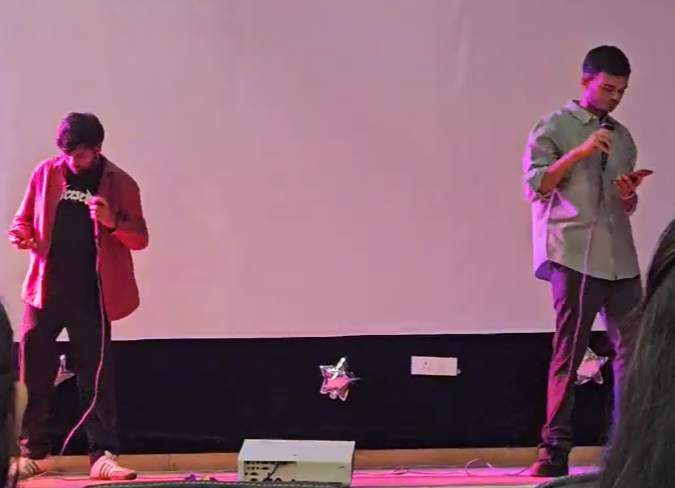
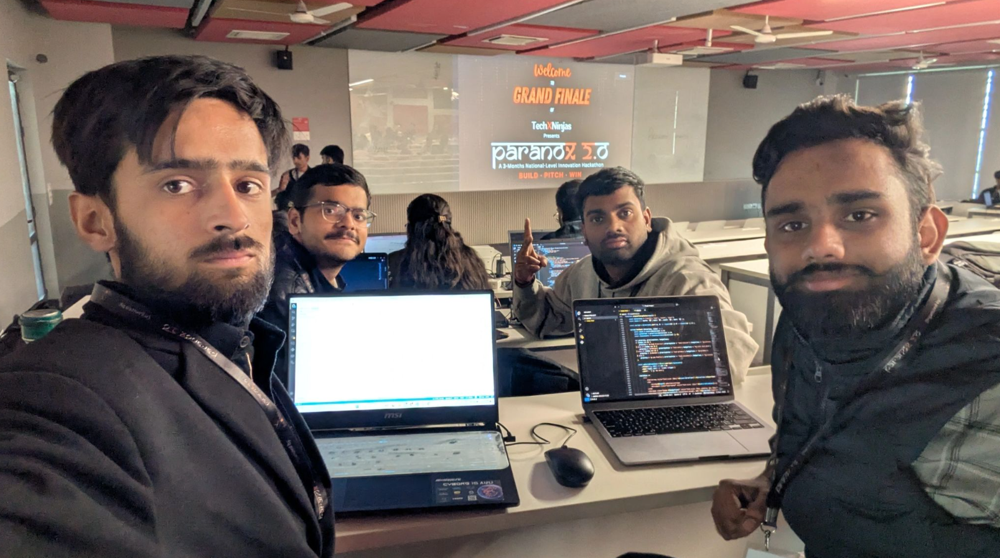
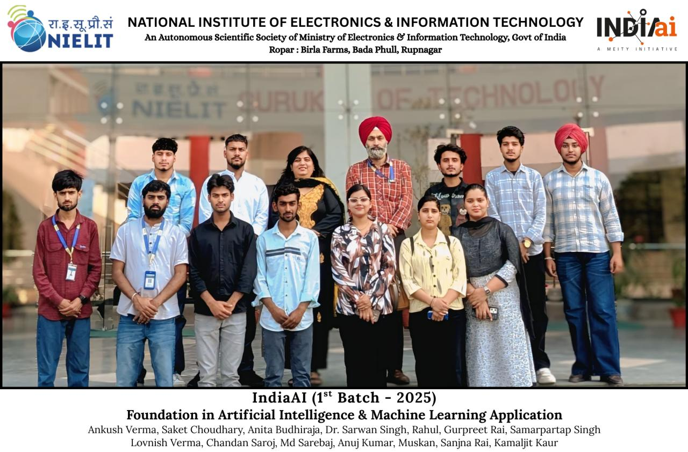

<!-- README.md -->

  <h1>🚀 Chandan Saroj: Data Science Specialist | AI/ML Trainer | Full-Stack Architect</h1>
  <h2><i>Generative AI • LLMs • RAG • Agentic AI • MERN Stack • AWS</i></h2>

  
  

 

  
  
  
  
  

  

 

  <h3>✨ EXPLORE MY WORK ✨</h3>
  

 

> **Data Science Specialist, AI/ML Trainer, and Full-Stack Software Engineer** with **5+ years** of experience delivering real-world data science solutions and conducting hands-on training in modern AI technologies. Currently serving as a **Data Science Trainer at HYI.AI** (delivering a 3-month AI/ML government program under **NITI Aayog**), and previously an **IndiaAI Trainer & SDE at NIELIT Ropar** and **MERN Stack Developer at Webcreaters**. I bridge advanced AI research—covering **Generative AI, LLMs, RAG, Agentic AI (CrewAI), and Computer Vision**—with production-grade full-stack and cloud architecture (**MERN, REST APIs, AWS, CI/CD**).

 

## 🌐 Quick Overview
- 🔭 **Current Role**: Data Science Trainer at **HYI.AI** (Bangalore, Karnataka) — delivered a 3-month intensive AI/ML & Data Science government program under **NITI Aayog**.
- 🎓 **Training Impact**: **5+ years** of implementation-based pedagogy across **NITI Aayog**, **MeitY IndiaAI (NIELIT)**, **15+ state-wide AI bootcamps**, and university intensives (**PIET, Lamrin Tech Skills University, Guru Nanak Dev University**).
- 🌱 **Research & AI**: Published researcher in **Springer** and **AIP Conference Proceedings** on Diffusion Models, Generative AI, NLP, and Audio Classification (**6 Citations** on Google Scholar).
- 🏆 **Recognition**: **Best Research Paper Award (NICEDT 2025)** and **2nd Runner-Up** at the **Paranox 2.0 National Hackathon** (Top 3 out of 1,552 projects).
- 📫 **Contact**: Reach me at [imjunior471@gmail.com](mailto:imjunior471@gmail.com)
- 📄 **Resume**: [View my full experience](https://drive.google.com/file/d/1X4eA4hn_IIsQ2_S6SK27XYW5kH1jewCN/view)
- 🎬 **Music & Content**: Creating music and tech content on [YouTube (SarojXCI)](https://www.youtube.com/@SarojXCI) and [Spotify](https://open.spotify.com/artist/0c9CWqibYvLSGpWfbSGKnv).

---

## 🛠️ AI/ML, Data Science & Full-Stack Tech Stack

### 🧠 AI, Data Science & Generative AI
**Core**: Large Language Models (LLMs), RAG, Agentic AI (CrewAI), Generative AI, Deep Learning, Neural Networks (CNN, RNN, LSTM), GANs, NLP, Computer Vision  
**Frameworks & Tools**: Python, TensorFlow, Keras, PyTorch, Scikit-Learn, Pandas, NumPy, NLTK, OpenCV, YOLOv8, Stable Diffusion, Hugging Face, Google Colab, Streamlit, Flask  

### 💻 Full-Stack & Cloud Architecture
**Languages**: Python, JavaScript (ES6+), TypeScript, SQL, C#, C/C++, ASP.NET, PHP  
**Stack**: MERN (MongoDB, Express.js, React.js, Node.js), REST APIs, Django, MVC, SSRS, Prisma ORM  
**Databases & Cloud**: AWS, Ubuntu Server Infrastructure, CI/CD Pipelines, MongoDB, Microsoft SQL Server, MySQL, Firebase  
**EdTech & Dev Tools**: Git, GitHub, Postman, Glitch, Google Visual Blocks, Google Teachable Machine, Power BI  

  
  
  
  
  
  
  
  
  
  
  
  

---

## 🚀 Featured Projects

- **[SmartLane AI (Paranox 2.0 National Hackathon — 2nd Runner-Up)]**  
  Real-time computer vision system built with **YOLOv8** and **TensorFlow**, achieving **99.2% accuracy** in emergency vehicle detection to dynamically optimize 4-way intersection signals.
- **[Generative AI Resume Summarizer]**  
  Abstractive summarization pipeline powered by fine-tuned **T5 Transformers, GANs, and TextRank** to automate candidate screening and highlight core skills. Published in **Springer**.
- **[SimpleBit Crypto Platform](https://simple-bit.com/)**  
  High-frequency cryptocurrency tracking and management platform architected on the **MERN stack** with real-time RESTful APIs.
- **[NIELIT Secure Question Paper Platform](https://nielit.ac.in/)**  
  A **leak-proof, encrypted question paper generation system** using **SHA-256 hashing in SQL Server**, ensuring zero plaintext exposure to DBAs, paired with automated SSRS PDF generation.
- **[The Hidout Booking Engine]**  
  Engineered and optimized core backend availability, reservation flows, and admin notification systems for a property management platform.
- **[E-Commerce NLP Analyzer]**  
  Sentiment analysis pipeline using **NLTK, Scikit-Learn, and Pandas** to evaluate consumer reviews and improve online product ranking metrics.
- **[Aksumbase Platform](https://aksumbase.com/)** & **[DriveAI Navigation]**  
  Scalable full-stack backend architecture and AI-guided automotive UX workflows.

---

## 📜 Research & Publications (6 Citations)

Explore my publications on [Google Scholar](https://scholar.google.com/citations?user=_7qIvaoAAAAJ&hl=en):
- **Best Paper Award (Springer, 2025):** *Generating House Floor Layout Images Using Diffusion Model* (Stable Diffusion, ResNet50, DINO)
- **Springer (2025):** *Audio Classification Using Deep Learning*
- **Springer (2024):** *Resume Summarization — An Application of Generative AI* — [Read Paper (DOI)](https://doi.org/10.1007/978-981-97-3604-1_40)
- **AIP Conference Proceedings (2024):** *Assessing Online Products Using NLTK Based Machine Learning Model* — [Read Paper (DOI)](https://doi.org/10.1063/5.0200871)

---

## 🏆 Achievements & Participations
- **NICEDT 2025**: Best Research Paper Award & Best Project Award in Artificial Intelligence and Machine Learning (plus Runner-Up for Research Presentation).
- **Paranox 2.0 National Hackathon**: 2nd Runner-Up (Top 3 out of 1,552 projects) for SmartLane AI.
- **Amazon ML Challenge 2023**: Selected participant in the national predictive machine learning hackathon.

---

## 🎯 Dual Passions: Code & Creativity

- **Chess**: Active player on [Chess.com](https://www.chess.com/member/chaupat_raja).
- **Music Production**: Independent rap artist — listen on [Spotify](https://open.spotify.com/artist/0c9CWqibYvLSGpWfbSGKnv) and watch studio sessions on [YouTube (SarojXCI)](https://www.youtube.com/@SarojXCI).
- **Traveling**: Exploring new places and cultures.

  

---

## 📸 Highlights & Journey

  <table>
    <tr>
      <td align="center"> In Press Release</td>
      <td align="center"> Winning Awards in AI Field</td>
      <td align="center"> Hackathon 2.0, 2nd Runner Up</td>
      <td align="center"> Music</td>
      <td align="center"> Coding Challenges</td>
      <td align="center"> MeitY Government Project: IndiaAI</td>
    </tr>
  </table>

